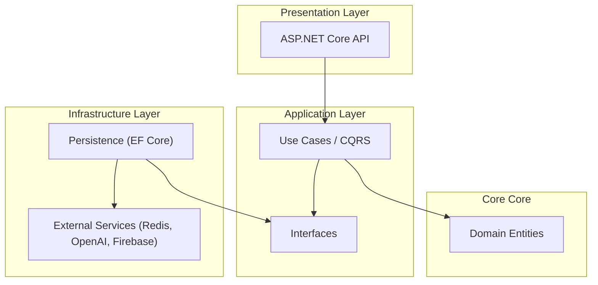

# 🚀 GigBuds - Smart Job Matching Platform

> **An AI-powered, real-time recruitment platform connecting freelancers with gigs instantly.**  
> *Built with .NET 9, Clean Architecture, and Vector Search.*


## 🌟 Overview

GigBuds is a next-generation platform designed to streamline the gig economy. Unlike traditional job boards, GigBuds leverages **Vector Embeddings (AI)** to semantically match job seekers with opportunities, ensuring high-quality connections. The system features a robust, **real-time chat** for instant negotiation, secure payments via **PayOS**, and a highly scalable backend architecture.

## ✨ Key Features

### 🧠 AI-Powered Job Recommendations
*   **Semantic Matching**: Utilizes **OpenAI embeddings** and **Redis Vector Search** to match candidates based on skills and bio, not just keywords.
*   **Smart Feed**: Personalized job feed tailored to user behavior and profile vectors.

### 💬 Real-Time Communication
*   **Instant Messaging**: Built on **SignalR** and **Redis** for sub-millisecond latency.
*   **Rich Chat Features**: Typing indicators, read receipts, and message history storage.
*   **Live Notifications**: Real-time alerts for new applications, messages, and job offers.

### 🛡️ Enterprise-Grade Reliability
*   **Clean Architecture**: Strictly separated layers (Domain, Application, Infrastructure, API) ensuring maintainability and testability.
*   **CQRS Pattern**: Implemented with **MediatR** for separation of read/write concerns.
*   **Background Processing**: **Quartz.NET** handles scheduled tasks (subscriptions, notifications) without blocking the API.

### 💳 Secure Finance & Operations
*   **Integrated Payments**: Seamless checkout and payout flow using **PayOS**.
*   **Identity Management**: Secure JWT authentication and RBAC (Role-Based Access Control).

## 🏗️ Technical Architecture

GigBuds follows the **Clean Architecture** principles to ensure loose coupling and independence of frameworks.



### Technology Stack

| Category | Technology |
|----------|------------|
| **Framework** | .NET 9 Web API |
| **Database** | PostgreSQL / SQL Server (via EF Core) |
| **Caching & Search** | Redis (StackExchange.Redis), Redis.OM (Vector Search) |
| **Real-time** | SignalR |
| **Messaging** | MediatR (In-process), MassTransit (Ready) |
| **Background Jobs** | Quartz.NET |
| **Storage** | Firebase Storage / Google Cloud Storage |
| **Deployment** | Docker, Docker Compose |
| **Monitoring** | Serilog, OpenTelemetry |

## 📂 Project Structure

```bash
Gigbuds_BE
├── Gigbuds_BE.API            # Entry point, Controllers, Middlewares
├── Gigbuds_BE.Application    # Business Logic, Features (CQRS), DTOs
│   ├── Features              # Modular features (JobPosts, Messaging, etc.)
│   └── Configurations        # App settings models
├── Gigbuds_BE.Domain         # Core Entities, Enums, Value Objects
└── Gigbuds_BE.Infrastructure # DB Context, External Service Implementations
```

## 🚀 Getting Started

### Prerequisites
*   [.NET 9 SDK](https://dotnet.microsoft.com/download/dotnet/9.0)
*   [Docker Desktop](https://www.docker.com/products/docker-desktop)
*   Redis (Stack or Container)

### Run Locally

1.  **Clone the repository**
    ```bash
    git clone https://github.com/yourusername/gigbuds-be.git
    cd Gigbuds_BE
    ```

2.  **Start Infrastructure (Redis & DB)**
    ```bash
    docker-compose -f docker-compose.prod.yml up -d
    ```

3.  **Run the API**
    ```bash
    cd Gigbuds_BE.API
    dotnet run
    ```

4.  **Access Documentation**
    *   Swagger UI: `https://localhost:5001/swagger`

## 🧪 Testing

The solution includes comprehensive unit and integration tests (located in `tests/` folder outside the main src tree).
*   Run tests: `dotnet test`

## 👥 Contributors

*   **EXE201 Team** - FPT University

---
## Other repositories

*   [GigBuds_FE](https://github.com/GigBuds/Gigbuds_FE)
*   [GigBuds_Mobile](https://github.com/GigBuds/Gigbuds_Mobile)
